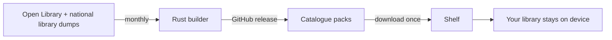

# Contributing

Contributions are welcome: bug reports, translations, catalogue ideas, code. Forking and
shipping your own build is fine too; the MIT license asks only for attribution.

## Setup

| Part | Needs |
|---|---|
| `android/` | JDK 25, Android SDK 37. `./gradlew assembleGithubDebug` |
| `tooling/builder/` | Rust stable. `cargo build --release` |
| `tooling/` | Python 3.11+ |

Open `android/` in Android Studio for the app; the repo root works for everything else.

## Workflow

1. Fork, branch off `master`.
2. Keep the change focused; one topic per pull request.
3. Run `./gradlew lintGithubDebug testGithubDebugUnitTest` in `android/`, or
   `cargo fmt --check && cargo clippy && cargo test` in `tooling/builder/`.
4. Update `README.md` (users) or this file (internals) when behaviour or layout changes.
5. Open the pull request and describe what changed and how you tested it.

## Style

Follow the surrounding code. Self-documenting names, early returns, shallow nesting, no
commentary that the code already states. `ktlint -F "android/app/src/**/*.kt"` for
Kotlin (configured in `.editorconfig`), `cargo fmt` for Rust.

## How it works



## Search and sort

**Search**: typo-tolerant, completes words, finds authors and ISBNs. Your own books
show first. Filter by genre or publication year, sort by relevance, popularity or date.

**Library**: search, shelf chips, and a sort and filter sheet (sort, genre, grid or
list). Genres group books automatically, no collections to maintain.

**Tablets**: navigation rail; wide windows (≥ 840 dp) open books in a pane beside the
list, back closes it. Grids and list view add columns with width. Reader text capped at
640 dp per line, extra width → margins. Window narrows → open book moves to full screen.

## Own books

Book missing from the catalogue? Library › **+**, or search it and tap
**Add "…" as own book**. Title, author and shelf stay on device. Cover drawn on device,
or tap it, in the sheet or on the book page, to pick your own image.
Library › file icon imports a book file instead (see [Formats](#formats)). Same file
twice → same book. Imported files and own covers move along on device transfer; cloud
backup keeps the library only, so re-import files there.

## Formats

Detected by content (magic bytes), extension only as fallback: a CBR that is really a ZIP
still opens. Title and author read on import where the format has them. Without a table
of contents, chapters start at `h1`–`h3` headings or a short centered first line. Same
file under another extension → same book, progress kept.

<table>
<tr><th width="1%">Kind</th><th width="1%">Extensions</th><th width="1%">Reads</th></tr>
<tr><td>EPUB</td><td><code>epub</code> <code>kepub</code></td><td>spine, nav/NCX chapters (also <code>#anchors</code> inside one file), images, styles</td></tr>
<tr><td>Kindle</td><td><code>mobi</code> <code>azw</code> <code>azw3</code> <code>kf8</code> <code>prc</code></td><td>MOBI 6 and KF8 (also joint files), PalmDOC and HUFF/CDIC, images, EXTH metadata; DRM refused. Chapters: MOBI 6 guide TOC, else page breaks</td></tr>
<tr><td>Palm</td><td><code>pdb</code></td><td>PalmDOC text or HTML, MOBI</td></tr>
<tr><td>FictionBook</td><td><code>fb2</code> <code>fbz</code> <code>fb2.zip</code></td><td>sections, styles, embedded images</td></tr>
<tr><td>PDF</td><td><code>pdf</code></td><td>pages via <code>PdfRenderer</code></td></tr>
<tr><td>Comics</td><td><code>cbz</code> <code>cbr</code> <code>cb7</code> <code>cbt</code></td><td>image pages, natural order; CBR only as ZIP</td></tr>
<tr><td>Office</td><td><code>docx</code> <code>odt</code> <code>rtf</code></td><td>headings (any Word language), bold/italic (DOCX), images (DOCX, ODT); comments skipped</td></tr>
<tr><td>Web, text</td><td><code>html</code> <code>htm</code> <code>xhtml</code> <code>htmlz</code> <code>txt</code> <code>txtz</code> <code>md</code></td><td>headings, styles; UTF-8 or Windows-1252</td></tr>
</table>

A plain `zip` opens as whatever it holds: EPUB, DOCX, ODT, FB2, HTML, images or text.
ZIP, 7z and tar via `java.util.zip` and
[Commons Compress](https://commons.apache.org/proper/commons-compress/); 7z and tar pages
unpack to the cache while open (2 GB cap), cleared on start. Kindle reader in
`data/Mobi.kt`, everything else in `data/Documents.kt`. Long scans use one `Matcher`
(`Regex.scan`): `findAll` re-copies the input per match on Android.

## Free books

Settings › **Free books**: one switch per source, all off by default. Book page › cloud
icon (online, no file yet) → sheet. Only switched-on sources serving the catalogue
language are contacted, in parallel. Per source: up to 8 title/author matches → their
`steps` (file, size, cover) → up to 5 offers. Tap one → file saved like an import,
reader opens. Failed or cancelled → nothing kept, tap to retry.

### Sources

Every source is a JSON recipe: data only, nothing executed. Built-ins ship in
[`assets/sources/`](../android/app/src/main/assets/sources) (file name = id) and serve as examples:
[Standard Ebooks](../android/app/src/main/assets/sources/standard-ebooks.json) (Atom feed),
[Project Gutenberg](../android/app/src/main/assets/sources/gutenberg.json) (OPDS + step),
[Wikisource](../android/app/src/main/assets/sources/wikisource.json) (JSON API, `skip`),
[Internet Archive](../android/app/src/main/assets/sources/internet-archive.json) (Lucene query, regex over JSON).

Own sources: Settings › Free books › **Own sources**. Create in form or file, import or
export `shelf-sources.json` (device only, not backed up). **Test** traces each request.

| Key | Meaning |
|---|---|
| `name`, `about` | settings row; `about` = language → text |
| `search` | `url`, optional `body` (POST), `items` rule, `fields` (`title` required) |
| `steps` | extra requests per candidate; each adds its `fields` |
| `download`, `cover` | file URL, optional cover URL |
| `format`, `languages` | `epub` default; empty `languages` = all |
| `headers` | sent only to the search host |

Rules: `css` → `json` (dot path) → `attr` → `regex` (first group); `<?xml` pages parse as
XML. Fields `size`, `format` describe the file, `skip` drops the item. `{name}` inserts
URL-encoded, `{+name}` raw. Variables: `{query}`, `{title}`, `{author}`,
`{titleWords}`, `{surname}`, `{language}`, `{language3}` (`ger`), `{languageName}`
(`German`), `{isbn}`, `{isbns}`, plus every field. Limits: https only, pages 5 MB,
files 200 MB, regex 2 s.

## Scan a cover

Search › scan icon (hidden without camera). Hold a cover in view: frames are matched
live against the **selected catalogue**; clear leader → vibration, frozen frame with
dots on the read title, sheet with book, shelf picker, **Scan again**. Tap → capture
with a lower threshold. ISBN barcodes (EAN-13, QR) are read with ZXing and looked up in
every installed catalogue.

On device, pure Kotlin, no network; camera via CameraX:

- `data/Lines.kt`: 1280×960 grayscale, deskew and line finding at ≤ 640 px, 48 px crops
  from the full frame
- `data/Recognizer.kt`: CNN for `assets/scan.bin` (PP-OCRv6 tiny, Apache-2.0,
  300 Latin characters, 1.2 MB), warmed up on open
- `data/Scan.kt`: orientation probed once and kept, top 8 lines read in parallel,
  typo-tolerant title/author matching; generic titles need the author, series names
  count half; stop rule over decaying scores

`scan.bin`: `SCAN`, version 3, line height, alphabet, layers (grouped/strided conv,
8/16-bit weights, squeeze-excite, pool). Built from source, byte for byte:

```sh
apt install python3-onnx python3-yaml python3-numpy   # or pip install onnx pyyaml numpy
python3 tooling/scan.py [out]                         # default: assets/scan.bin
```

`tooling/scan.py` downloads `PaddlePaddle/PP-OCRv6_tiny_rec_onnx` at a pinned Hugging
Face commit, checks SHA-256, folds batch norm, keeps Latin characters, quantizes to
16 bit. Math in float64 → same bytes across numpy/BLAS versions. CI `scan` job
rebuilds it on Debian trixie and fails on any diff. F-Droid recipe: `rm` the asset,
`sudo` installs the three packages, `build: python3 ../../tooling/scan.py`.
Bench data and training: gitignored `scanbench/`; `./gradlew scanBench` simulates
real-time scanning (`--tune`, `--rematch` rescores stored lines without OCR).

## Catalogue

<table>
<tr><th width="1%">Type</th><th width="1%">Contents</th></tr>
<tr><td>Languages</td><td>English · Deutsch · Français · Español · Eesti · Svenska · Polski · Čeština · 한국어 · Suomi</td></tr>
<tr><td>Genre packs</td><td>fantasy · scifi · mystery · romance</td></tr>
<tr><td>More packs</td><td>kids · young-adult · nonfiction · general</td></tr>
</table>

English `core` and `ranks` ship in the APK (`bundledLanguage`). Other languages and
packs download on demand, verified by SHA-256; onboarding requires the chosen
language's `core` unless it is installed. Language pickers (app and catalogue) show
native names as chips: English, Deutsch, Français, Español plus the chosen and installed
ones; **Show all** reveals the rest. ✓ marks the chosen one, a download mark installed
catalogues.
Packs include ISBNs of editions in their language; older apps ignore them.

<table>
<tr><th width="1%">Source</th><th width="1%">Use</th><th width="1%">Licence</th></tr>
<tr><td><a href="https://openlibrary.org/developers/dumps">Open Library</a></td><td>works, editions, readers, covers</td><td>CC0</td></tr>
<tr><td><a href="https://data.dnb.de/opendata/">DNB</a> title dump</td><td>German editions, series, volumes, ISBNs, audience</td><td>CC0</td></tr>
<tr><td><a href="https://data.digar.ee/">ERB</a> Estonian books</td><td>Estonian editions, series, volumes, ISBNs, genres, DIGAR covers</td><td><a href="https://doi.org/10.5281/zenodo.8228805">CC0</a></td></tr>
<tr><td><a href="https://www.bnf.fr/fr/les-donnees-de-la-bnf">BnF</a> Bibliographie nationale</td><td>French editions, series, volumes, ISBNs, audience</td><td>Licence Ouverte</td></tr>
<tr><td><a href="https://libris.kb.se/">LIBRIS</a> instances + persons</td><td>Swedish editions, series, ISBNs, genres, authors</td><td>CC0</td></tr>
<tr><td><a href="https://data.bn.org.pl/">BN</a> books, e-books</td><td>Polish editions, series, volumes, ISBNs, genres</td><td>CC0</td></tr>
<tr><td><a href="https://aleph.nkp.cz/data/">NKP</a> national catalogue</td><td>Czech editions, series, volumes, ISBNs, genres</td><td>CC0</td></tr>
<tr><td><a href="https://lod.nl.go.kr/">NLK</a> LOD books</td><td>Korean editions, series, ISBNs, KDC forms</td><td>KOGL type 1</td></tr>
<tr><td><a href="https://data.nationallibrary.fi/">Fennica</a></td><td>Finnish editions, series, volumes, ISBNs, genres</td><td>CC0</td></tr>
</table>

One library per catalogue: DNB → de, ERB → et, BnF → fr, LIBRIS → sv, BN → pl, NKP → cs,
NLK → ko, Fennica → fi. Join Open Library works by ISBN, else title or original title +
author; per language, so editions never cross catalogues. Missing works get stable ids
(DNB 1,000,000,000+, LIBRIS 1,200,000,000+, then 100,000,000 per library, ERB
2,000,000,000+; all below 2³¹ for the app); later Open Library match → alias. Rank below
Open Library books with readers. Joined works keep Open Library title unless every
local Open Library edition title is foreign, take library series. Series with ≥ 3
writers whose titles don't name it are publisher series and dropped. Genre-only pulp
issues (`Dr. Norden 631 - Arztroman`) skipped.

MARC libraries (ERB, BN, NKP, Fennica; `marc.rs`, binary or XML): language from 008/35,
literature from 008/33 fiction form, UDC `821`, YKL 80–85 or a literary 655/380 genre;
textbook, activity, colouring, song books skipped; 008/22 audience; genres → tags;
245 `$n`/`$p`, 490/830 → series (`/ author` cut); volumes over 40 keep `Title N` without
series; 240 or 246 (translations) → original title. BnF UNIMARC: 101 `fre`, 105/11
literature code, 100/17 audience, 686 class (803 novels, 801 poetry, 802 drama, 805
comics, 809 children), 200 `$h`/`$i` volumes, 225/461 series, 454 original.
LIBRIS (`linked.rs`): Swedish instances with literary genre/form term or SAB `H`
class; authors inline, from the persons dump, else statement of responsibility.
NLK: Korean books with KDC 8x1–8x3 or literary keyword; `(…)` title prefixes dropped.
Korean titles prefer Hangul spellings over romanized Open Library ones.

Titles drop series/volume prefixes (`Gregs Tagebuch 01 . Von Idioten umzingelt!` →
`Von Idioten umzingelt!`, `Band 2: Orwood` → `Orwood`), edition tags, `. Roman.`,
trailing dots. Prefix naming writer's series → joins it. Series names searchable. Same
title + writer (surname, first initial) → one book.

Covers: Open Library → DNB (ISBN), DIGAR thumbnail (ERB 856 `nlib-digar` id), Bookbites
(LIBRIS, ISBN) or Open Library by ISBN (other libraries), view time only → drawn. Wide
jacket scans show front half. Author photos from Open Library follow **Online covers**.

Search folds Latin accents (Polish, Czech too) and keeps Hangul syllables; builder and
app tokenize alike.

## Build

```sh
cd android
./gradlew assembleGithubDebug
./gradlew testGithubDebugUnitTest testFdroidDebugUnitTest
./gradlew assembleGithubRelease -PlocalCatalogue=<builder out dir>
```

```sh
cd tooling/builder && cargo build --release
target/release/builder <dumps> <out> [--previous <dir>] [--base-url <url>] \
  [--languages sv,fi] [--dump <dir>] \
  [--library dnb=<dnb-all_lds.rdf.gz or url>] \
  [--library erb=<ERB_eestikeelne_raamat.zip or url>] \
  [--library bnf=<P174_*.zip>]... \
  [--library libris=<libris-instances.ndjsonld.gz>,<libris-persons.ndjsonld.gz>] \
  [--library bnp=<bibs-ksiazka.marc>] [--library bnp=<bibs-e_book.marc>] \
  [--library nkp=<nkc.xml.gz>] [--library nlk=<book_json_*.zip>] \
  [--library fennica=<Fennica-bib-*.zip>]
```

`--languages` builds only those catalogues: other languages' editions, titles and
eligibility are skipped (faster, less RAM); `manifest.json` lists only them. Libraries
load in parallel; zips are read entry by entry. `--dump` writes `<language>.tsv` (id,
score, pack, title, alternate, authors, series, year, ISBNs) for review.

`.github/workflows/database.yml` (monthly), every source downloaded once:

| Job | Does |
|---|---|
| `prepare` | release name, previous catalogue tag |
| `dumps` | Open Library dumps from archive.org → artifact `openlibrary` (1 day) |
| `tools` | builder binary → artifact `builder`; NLLB 3.3B → int8 model cache (converted only on cache miss) |
| `build` × 10 | one per language, in parallel: artifacts + cached model + its library dump (BnF via `tooling/bnf.py`, `BNF_LINK`/`BNF_FOLDERS` change yearly; NLK and Fennica names discovered) → `--languages <lang>` build and translation |
| `publish` | merge per-language manifests, create release, prune |

Flavors, set in `distributions` (`app/build.gradle.kts`):

<table>
<tr><th width="1%">Flavor</th><th width="1%">Catalogue</th><th width="1%">scan.bin</th><th width="1%">Updater</th><th width="1%">Transfer service</th><th width="1%">Release asset</th></tr>
<tr><td><code>github</code></td><td>core, ranks</td><td>yes</td><td>yes</td><td>yes</td><td><code>shelf.apk</code></td></tr>
<tr><td><code>update</code></td><td>manifest only</td><td>no</td><td>yes</td><td>yes</td><td><code>shelf-update.apk</code></td></tr>
<tr><td><code>fdroid</code></td><td>manifest only</td><td>yes</td><td>no</td><td>no</td><td><code>shelf-fdroid.apk</code></td></tr>
</table>

`fdroid` permissions: camera, internet only. `src/fdroid/AndroidManifest.xml` removes
install, foreground service and androidx dynamic receiver permissions, so transfers run
without a foreground notification.

In-app update downloads `shelf-update.apk` (smaller). Before install, bundled packs and
`scan.bin` are copied to app storage, so they survive; a full APK deletes the copies on
start. `shelf-fdroid.apk` is the F-Droid recipe's `Binaries:` reference: F-Droid
rebuilds it from source and ships it only if the builds match.

Size: only app locales and compressed native libs ship. `inter.ttf` is Inter at `opsz`
14, `wght` 400–800, without private-use glyphs (`fonttools varLib.instancer`,
`pyftsubset`).

Format with `ktlint -F "android/app/src/**/*.kt"`.

Store screenshots (root AVD `shelf-screenshots` or `SHELF_AVD`, app installed, `ffmpeg`):
`python3 tooling/screenshots.py [--only 7_scan|8_settings]`.
Scan shot: emulator camera plays a rendered book-on-table loop; taps to capture after 30 s.
`scroll_to(label)` scrolls until nothing visible sits above that section header, so use it
for any section shot. Tab, settings, cover and scan labels come from
`values-<lang>/strings.xml`, so Weblate translations reach the screenshots. Only headlines
and demo books live in the script.
Each language downloads its packs via Settings › Catalogue (Russian has none and uses the
English catalogue). Demo books are picked per catalogue: titles and covers from that
catalogue, a series book for the series shot. The scan shot needs a Latin-script cover:
the recognizer reads Latin text only. Demo mode is re-applied after each theme switch;
Hangul headlines use Noto Sans CJK KR (`fc-match`).

GitHub social preview: `python3 tooling/thumbnail.py [out]` → `android/design/thumbnail.jpg`
(1280×640, phones cut from en-US store screenshots). Upload it in repo Settings › Social
preview; Pages serves it as `og:image`.

Scanner bench (local `scanbench/cache` clips; `--tune` grid-searches the stop rule):

```sh
cd android
./gradlew scanBench --args="bench tune [--reuse] [--tune]"
```

## Website

`.github/site/` → https://shelf.tn3w.dev via `.github/workflows/pages.yml` on push to
`master`. Workflow adds icon, thumbnail (`og:image`), covers and screenshots as WebP,
then minifies.

## Project

<table>
<tr><th width="1%">Path</th><th width="1%">Role</th></tr>
<tr><td><code>android/</code></td><td>App</td></tr>
<tr><td><code>tooling/builder/</code></td><td>Catalogue builder (Rust)</td></tr>
<tr><td><code>tooling/</code></td><td>Screenshots, thumbnail, translation, promo, scanner model</td></tr>
<tr><td><code>.github/site/</code></td><td>Static website</td></tr>
</table>

## Translate

App strings (component `app`) and store listing (component `fastlane`: title, short and
full description, changelogs `1`–`16` per language under
`android/app/fastlane/metadata/android/<lang>/`) are translated on
[Hosted Weblate](https://hosted.weblate.org/engage/shelf/). Weblate opens pull requests
from its `weblate` branch. Store texts are limited to 30 (title), 80 (short), 4000 (full)
and 500 (changelog) characters. App languages: ten catalogue languages plus Russian.

## Reporting

Use the issue templates. Security issues go to [SECURITY.md](SECURITY.md) instead of the
tracker.
