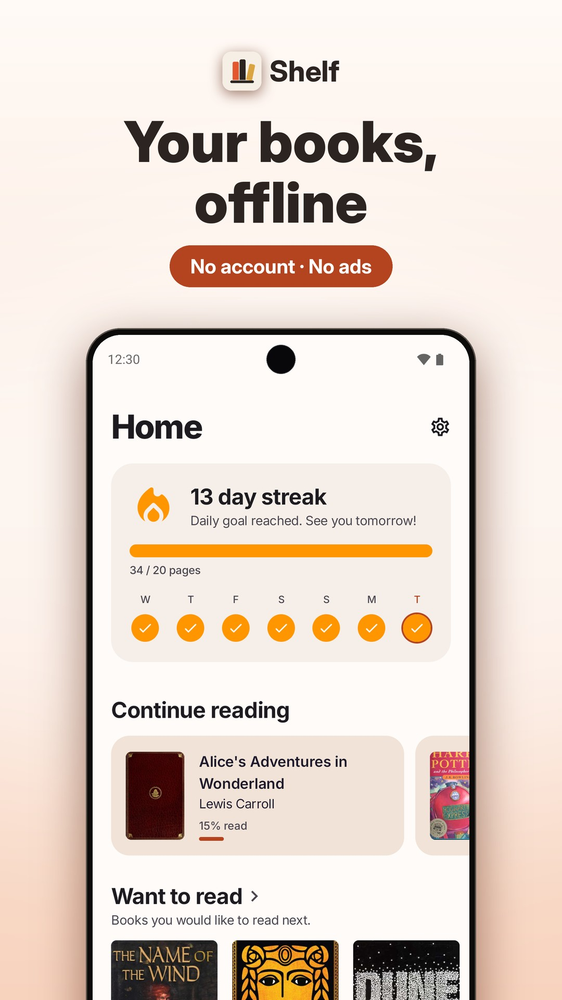
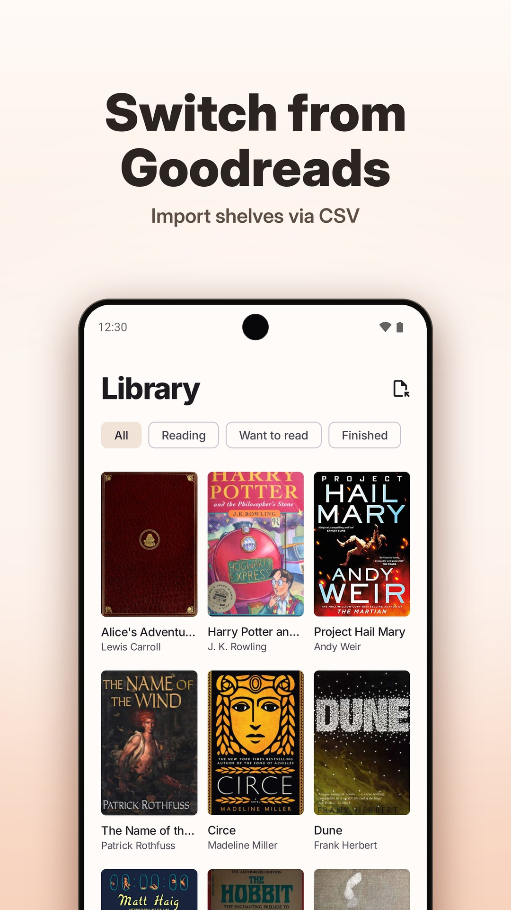
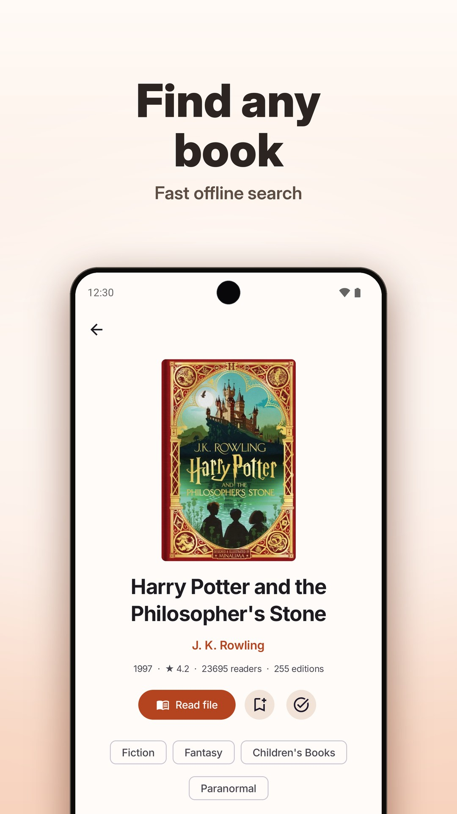
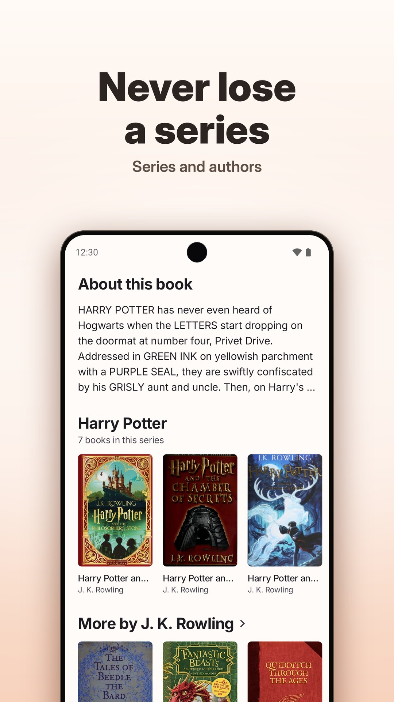
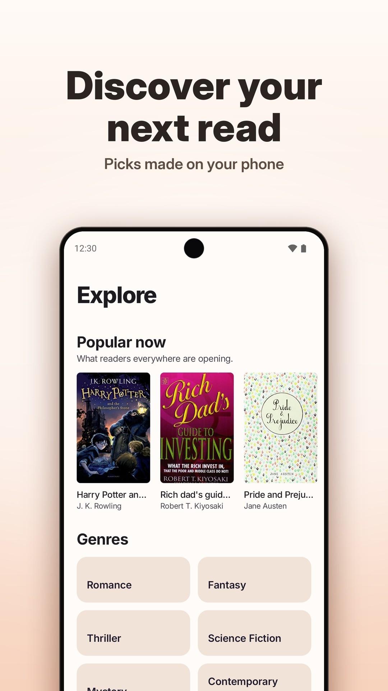
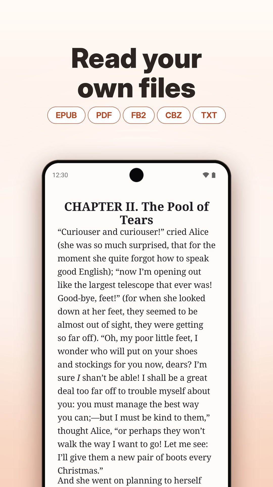
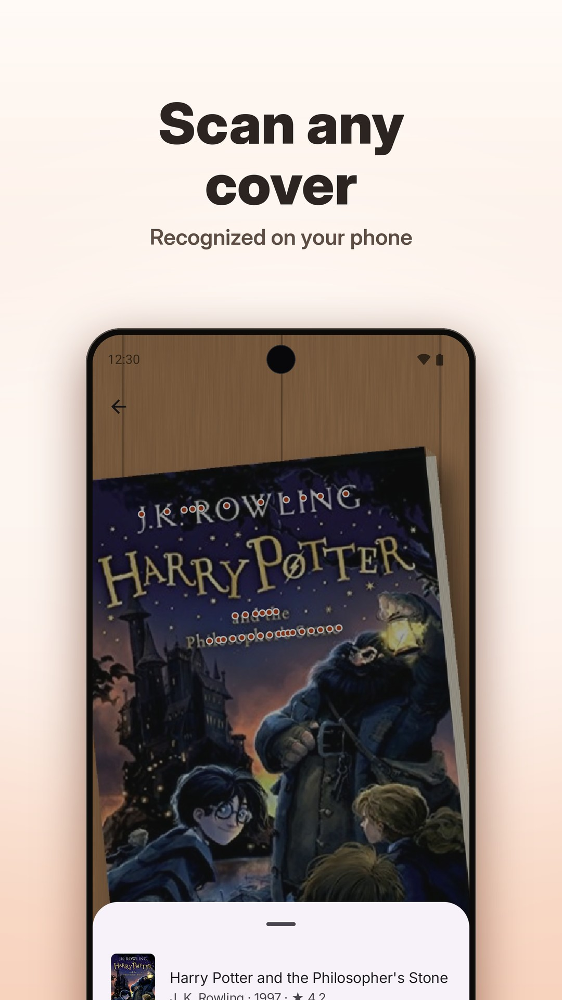
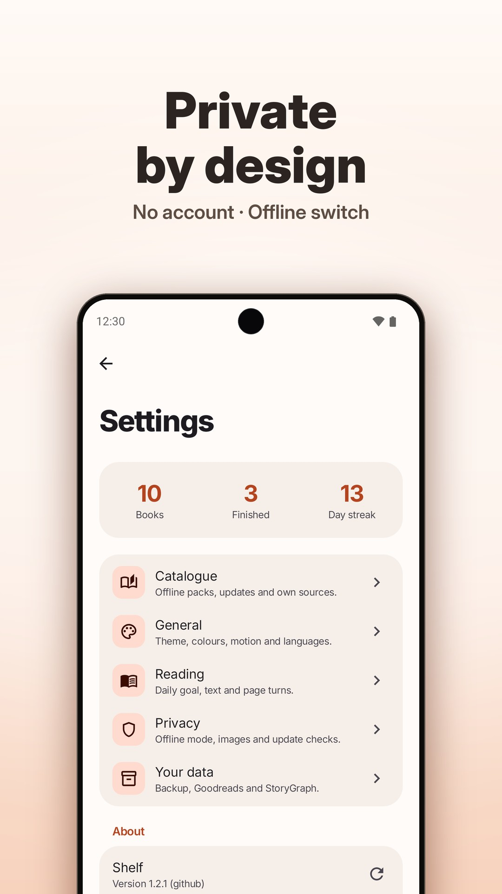
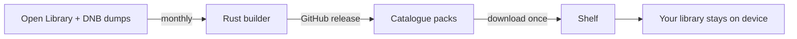

<div align="center">


# Shelf

**Offline book catalogue for Android.**
Search, explore, track reading streaks, read your own files.

[](https://github.com/tn3w/Shelf/releases/latest)
[](https://github.com/tn3w/Shelf/releases)
[](https://www.android.com)
[](https://kotlinlang.org)
[](https://developer.android.com/compose)
[](https://hosted.weblate.org/engage/shelf/)

<a href="https://github.com/tn3w/Shelf/releases/latest/download/shelf.apk"></a>
<a href="https://apps.obtainium.imranr.dev/redirect?r=obtainium://app/%257B%2522id%2522%253A%2522dev.tn3w.shelf%2522%252C%2522url%2522%253A%2522https%253A%252F%252Fgithub.com%252Ftn3w%252FShelf%2522%252C%2522author%2522%253A%2522tn3w%2522%252C%2522name%2522%253A%2522Shelf%2522%252C%2522additionalSettings%2522%253A%2522%257B%255C%2522apkFilterRegEx%255C%2522%253A%255C%2522%255Eshelf%255C%255C%255C%255C.apk%2524%255C%2522%257D%2522%257D"></a>
<a href="https://f-droid.org/packages/dev.tn3w.shelf/"></a>

<p align="center">
<picture><source media="(prefers-color-scheme: dark)" srcset="android/design/screenshots/dark/1_home.jpg"></picture>
<picture><source media="(prefers-color-scheme: dark)" srcset="android/design/screenshots/dark/2_library.jpg"></picture>
<picture><source media="(prefers-color-scheme: dark)" srcset="android/design/screenshots/dark/3_book.jpg"></picture>
<picture><source media="(prefers-color-scheme: dark)" srcset="android/design/screenshots/dark/4_series.jpg"></picture>
<br>
<picture><source media="(prefers-color-scheme: dark)" srcset="android/design/screenshots/dark/5_explore.jpg"></picture>
<picture><source media="(prefers-color-scheme: dark)" srcset="android/design/screenshots/dark/6_reader.jpg"></picture>
<picture><source media="(prefers-color-scheme: dark)" srcset="android/design/screenshots/dark/7_scan.jpg"></picture>
<picture><source media="(prefers-color-scheme: dark)" srcset="android/design/screenshots/dark/8_settings.jpg"></picture>
</p>

https://github.com/user-attachments/assets/5ffe8161-7070-4fbc-8a89-836da15b2b37

</div>

## Features

<table>
<tr><th width="1%">Find</th><th width="1%">Read</th><th width="1%">Track</th></tr>
<tr><td align="center">Typo-tolerant search with filters, cover scanner</td><td align="center">EPUB · PDF · FB2 · CBZ · TXT · HTML</td><td align="center">Want · Reading · Finished</td></tr>
<tr><td align="center">Genres, series, authors, free ebooks</td><td align="center">Paper and night pages</td><td align="center">Daily goal and streaks</td></tr>
<tr><td align="center">Recommendations on device</td><td align="center">Volume and page keys</td><td align="center">Goodreads / StoryGraph import</td></tr>
</table>

## How it works



## Privacy

<table>
<tr><th width="1%">What</th><th width="1%">Shelf</th></tr>
<tr><td>Accounts, trackers, ads</td><td><b>none</b></td></tr>
<tr><td>First launch</td><td><b>no request</b></td></tr>
<tr><td>Offline mode</td><td><b>one switch</b> cuts all network</td></tr>
<tr><td>Cover scanner</td><td><b>on device</b>, no request, frames never stored</td></tr>
<tr><td>Requests</td><td>https only (own sources: http on local network too), no identifiers, no cookies</td></tr>
<tr><td>Hosts</td><td>GitHub, Open Library, DNB covers, or <b>your own server</b></td></tr>
<tr><td>Free books</td><td><b>off</b>, each source opt-in, contacted only on search; own sources are data, no scripts</td></tr>
</table>

## Search and sort

**Search**: typo-tolerant, completes words, finds authors and ISBNs. Your own books
show first. Filter by genre or publication year, sort by relevance, popularity or date.

**Library**: search, shelf chips, and a sort and filter sheet (sort, genre, grid or
list). Genres group books automatically, no collections to maintain.

## Own books

Book missing from the catalogue? Library › **+**, or search it and tap
**Add "…" as own book**. Title, author and shelf stay on device. Cover drawn on device,
or tap it, in the sheet or on the book page, to pick your own image.
Library › file icon imports an EPUB, PDF, FB2, CBZ, TXT or HTML file instead. Same file
twice → same book. Imported files and own covers move along on device transfer; cloud
backup keeps the library only, so re-import files there.

## Free books

Settings › **Free books**: one switch per source, all off by default. Book page › cloud
icon (online, no file yet) → sheet. No source on → pick them right there, then Search.
Only switched-on sources serving the catalogue language are contacted, in parallel.

Per source: search → up to 8 candidates (all title words except articles, a shared author
word, shortest title first) → optional details lookup per candidate, in parallel (real
file, size; drops audio books, private files, files over 200 MB) → up to 5 matches with
cover (if covers are on), author, format, size. Unreachable source → tap to retry.
Tap a match → EPUB lands in `filesDir/books` like an import, book moves to Reading, reader
opens. Wrong file type, failed or cancelled (sheet closed) → nothing kept, tap to retry.

<table>
<tr><th width="1%">Source</th><th width="1%">Search</th><th width="1%">File</th></tr>
<tr><td><a href="https://standardebooks.org">Standard Ebooks</a></td><td>Atom feed, English</td><td>compatible EPUB</td></tr>
<tr><td><a href="https://www.gutenberg.org">Project Gutenberg</a></td><td>OPDS search in catalogue language (<code>l.de</code>)</td><td>EPUB 3 with images, from the book's OPDS entry</td></tr>
<tr><td><a href="https://wikisource.org">Wikisource</a></td><td>MediaWiki search on the language wiki; drops subpages, disambiguation and versions pages</td><td>EPUB 3 via WS Export</td></tr>
<tr><td><a href="https://archive.org">Internet Archive</a></td><td>advanced search: texts with EPUB in catalogue language, no lending, no community uploads</td><td>EPUB from the item's file list</td></tr>
</table>

New built-in source: one `object : FeedProvider()` in `data/Providers.kt`, added to
`PROVIDERS`, plus its `about` string. Pure functions, network stays in `search()`:

| Member | Role |
|---|---|
| `id`, `name`, `site`, `about`, `languages` | settings row; empty `languages` = all |
| `searchUrl(query)` → `offers(body, query)` | search request and parser |
| `detailsUrl(offer)` → `details(offer, body)` | optional second lookup; `null` drops the offer |

Anything else implements `Provider` (`find`, `complete`, `open`) directly, like own sources.
Atom/OPDS parse with Jsoup (`xml()`), JSON with kotlinx serialization. Requests send
`User-Agent: Shelf (https://github.com/tn3w/Shelf)` as Wikimedia asks.
Checked, not usable: DOAB and OAPEN (API blocks clients), Library of Congress and
Gallica (Cloudflare challenge), Feedbooks (closed).

### Own sources

Settings › Free books › **Own sources**: any site, local server or API as a JSON *recipe*.
Data only, nothing executed. Create in the form or File tab, import a `.json` (one recipe or
a list), export all to `shelf-sources.json`. **Test** runs every step for the first result
without downloading and traces each request; **Debug test** adds headers, pages and items
and saves `shelf-source-debug.txt` (header values hidden).

| Key | Meaning |
|---|---|
| `name` | shown in settings and the sheet |
| `search` | `url`, optional `body` (POST), `items` rule, `fields` (`title` required) |
| `steps` | run in order on download; each adds its `fields` as variables |
| `download` | file URL; redirects followed |
| `format`, `languages` | `epub` default; catalogue languages served, empty = all |
| `headers` | sent with every request, dropped when a redirect changes host |

Rules apply `css` → `json` (dot path) → `attr` → `regex` (first group). `{name}` inserts
URL-encoded, `{+name}` as is. Search knows `{query}`, `{title}`, `{author}`, `{language}`,
`{isbn}`, `{isbns}`; with `{isbn}` up to 5 of the book's ISBNs are tried. Relative URLs
resolve against the previous page. `http://` only for local hosts. Pages 30 s / 5 MB,
files 120 s, regex 2 s.

```json
{
  "name": "Library API",
  "search": {
    "url": "https://api.example.org/v2/search",
    "body": "{\"isbn\":\"{+isbn}\"}",
    "items": { "json": "data.results" },
    "fields": {
      "title": { "json": "name" },
      "author": { "json": "authors.0" },
      "id": { "json": "id" }
    }
  },
  "steps": [
    {
      "url": "https://api.example.org/v2/books/{id}/tickets",
      "body": "{\"format\":\"epub\"}",
      "fields": { "ticket": { "json": "ticket.id" } }
    },
    {
      "url": "https://api.example.org/v2/tickets/{ticket}",
      "fields": { "file": { "json": "links.epub" } }
    }
  ],
  "download": "{+file}",
  "headers": { "X-Api-Key": "…", "Content-Type": "application/json" }
}
```

ISBN search → order ticket → read signed link → download from the CDN, which gets no API
key. Recipes stay in `files/sources.json`: no cloud backup, no library export.

## Scan a cover

Search › scan icon (hidden without camera). Hold a cover in view: frames are matched
live against the **selected catalogue**; clear leader → vibration, frozen frame with
dots on the read title, sheet with book, shelf picker, **Scan again**. Tap → capture
with a lower threshold. ISBN barcodes (EAN-13, QR) are read with ZXing and looked up in
every installed catalogue.

On device, pure Kotlin, no network:

- `data/Lines.kt`: 1280×960 grayscale, deskew, edge-based line finding, 48 px crops
- `data/Recognizer.kt`: CNN for `assets/scan.bin` (PP-OCRv6 tiny, Apache-2.0,
  300 Latin characters, 1.2 MB), exact parity with the reference
- `data/Scan.kt`: orientation, best 6 of 8 lines, typo- and glued-word-tolerant
  title/author matching, stop rule over decaying scores

`scan.bin`: `SCAN`, version 3, line height, alphabet, layers (grouped/strided conv,
8/16-bit weights, squeeze-excite, pool). Built from source, byte for byte:

```sh
apt install python3-onnx python3-yaml python3-numpy   # or pip install onnx pyyaml numpy
python3 tooling/scan.py [out]                         # default: assets/scan.bin
```

`tooling/scan.py` downloads `PaddlePaddle/PP-OCRv6_tiny_rec_onnx` at a pinned Hugging
Face commit, checks SHA-256, folds batch norm, keeps Latin characters, quantizes to
16 bit. Math in float64 → same bytes across numpy/BLAS versions. CI `scan` job
rebuilds it on Debian trixie and fails on any diff. F-Droid recipe: `rm` the asset,
`sudo` installs the three packages, `build: python3 ../../tooling/scan.py`.
Bench data and training: gitignored `scanbench/`.

## Switch from Goodreads or StoryGraph

```
Export CSV  →  Settings › Your data › Import CSV  →  done
```

Shelves, ratings and read dates carry over. Books match by ISBN, then title and author.
Books not in the catalogue become your own.
Export writes the same format back.

## Catalogue

<table>
<tr><th width="1%">Type</th><th width="1%">Contents</th></tr>
<tr><td>Languages</td><td>English · Deutsch · Français · Español</td></tr>
<tr><td>Genre packs</td><td>fantasy · scifi · mystery · romance</td></tr>
<tr><td>More packs</td><td>kids · young-adult · nonfiction · general</td></tr>
</table>

`core` ships in the APK. Other packs download on demand, verified by SHA-256.
Packs include ISBNs of editions in their language; older apps ignore them.

<table>
<tr><th width="1%">Source</th><th width="1%">Use</th><th width="1%">Licence</th></tr>
<tr><td><a href="https://openlibrary.org/developers/dumps">Open Library</a></td><td>works, editions, readers, covers</td><td>CC0</td></tr>
<tr><td><a href="https://data.dnb.de/opendata/">DNB</a> title dump</td><td>German editions, series, volumes, ISBNs, audience</td><td>CC0</td></tr>
</table>

DNB only enriches the German catalogue. Its records join Open Library works by ISBN, else
by title plus author. Books missing from Open Library get stable ids from 1,000,000,000;
if Open Library gains one later, an alias moves saved entries. They rank below Open
Library books with readers.

Covers: Open Library → DNB by ISBN, loaded at view time (not CC0, never packed) → drawn.
German settings can change the DNB cover server.

## Generated covers

<p align="center">
<picture><source media="(prefers-color-scheme: dark)" srcset="android/design/covers-dark.jpg"></picture>
</p>

Books without a cover get one drawn on device. Same book, same cover. Art style follows
genre from catalogue tags, also for saved books.

Every design follows one minimal system: flat colors, one motif, no textures or frames.
Title on top in serif, sans or condensed. Author in small caps at the bottom.

## Build

```sh
cd android
./gradlew assembleGithubDebug
./gradlew testGithubDebugUnitTest testFdroidDebugUnitTest
./gradlew assembleGithubRelease -PlocalCatalogue=<builder out dir>
```

```sh
cd builder && cargo build --release
target/release/builder <dumps> <out> [--previous <dir>] [--base-url <url>] \
  [--library dnb=<dnb-all_lds.rdf.gz or url>]
```

Format with `ktlint -F "android/app/src/**/*.kt"`.

Store screenshots (root AVD `shelf-screenshots` or `SHELF_AVD`, app installed, `ffmpeg`):
`python3 tooling/screenshots.py [--only 7_scan|8_settings]`.
Scan shot: emulator camera plays a rendered book-on-table loop; taps to capture after 30 s.

Scanner bench (local `scanbench/cache` clips; `--tune` grid-searches the stop rule):

```sh
cd android
./gradlew scanBench --args="bench tune [--reuse] [--tune]"
```

## Website

`site/` → https://shelf.tn3w.dev via `.github/workflows/pages.yml` on push to `master`.
Workflow adds icon, covers and screenshots as WebP, then minifies.

## Translate

App strings and store listing are translated on
[Hosted Weblate](https://hosted.weblate.org/engage/shelf/). Weblate opens pull requests
from its `weblate` branch.

## Project

<table>
<tr><th width="1%">Path</th><th width="1%">Role</th></tr>
<tr><td><code>android/</code></td><td>App</td></tr>
<tr><td><code>builder/</code></td><td>Catalogue builder</td></tr>
<tr><td><code>tooling/</code></td><td>Screenshots, translation, promo, scanner model</td></tr>
<tr><td><code>site/</code></td><td>Static website</td></tr>
</table>

[Contributing](CONTRIBUTING.md) · [Security](SECURITY.md) ·
[Code of conduct](CODE_OF_CONDUCT.md) · [MIT License](LICENSE) ·
Data from [Open Library](https://openlibrary.org) and the
[Deutsche Nationalbibliothek](https://www.dnb.de)
