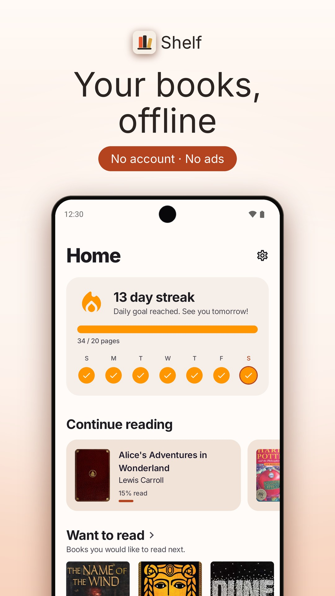
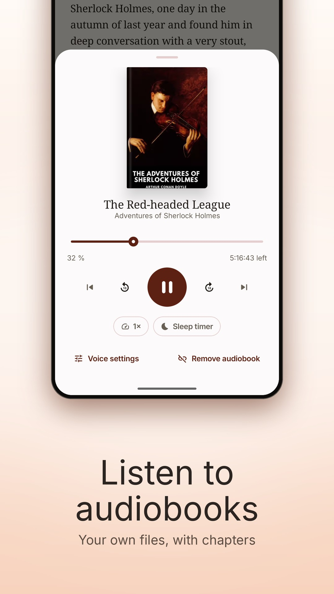
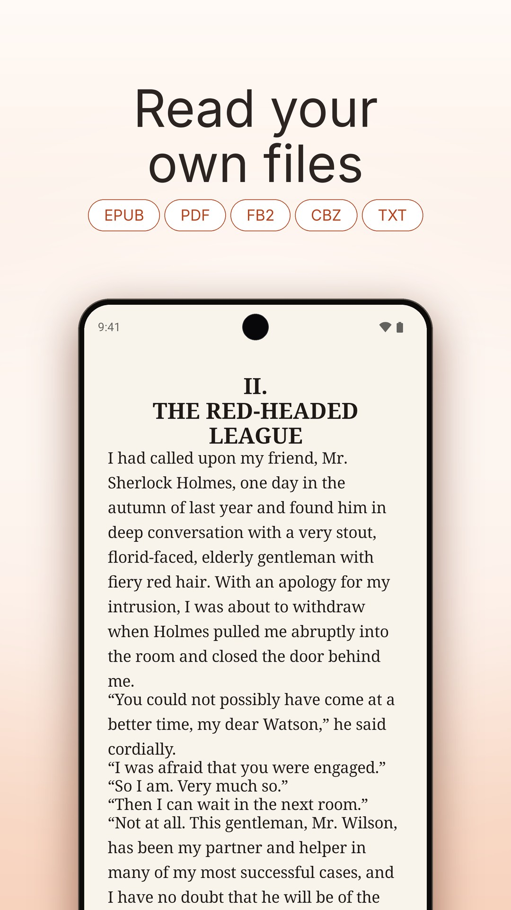
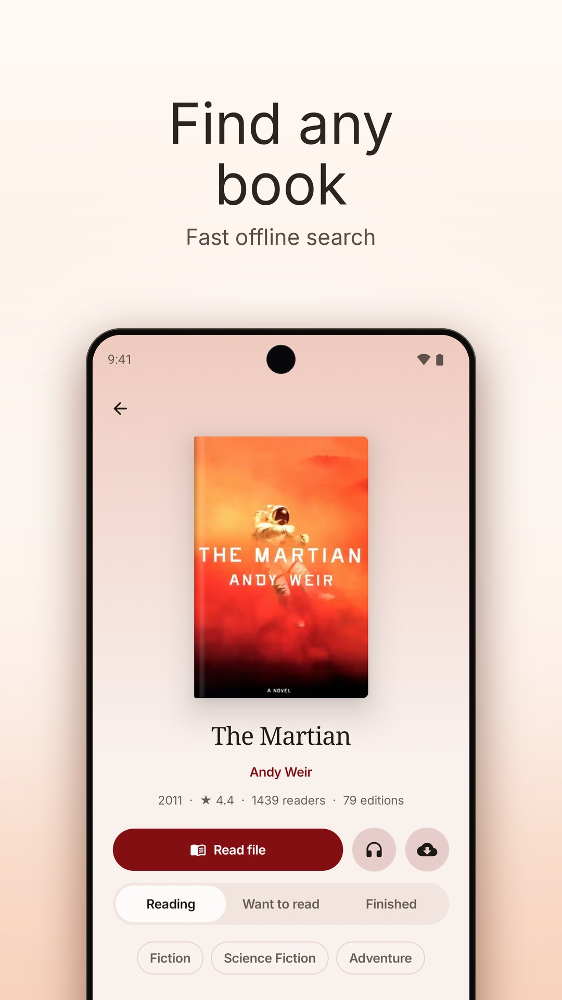
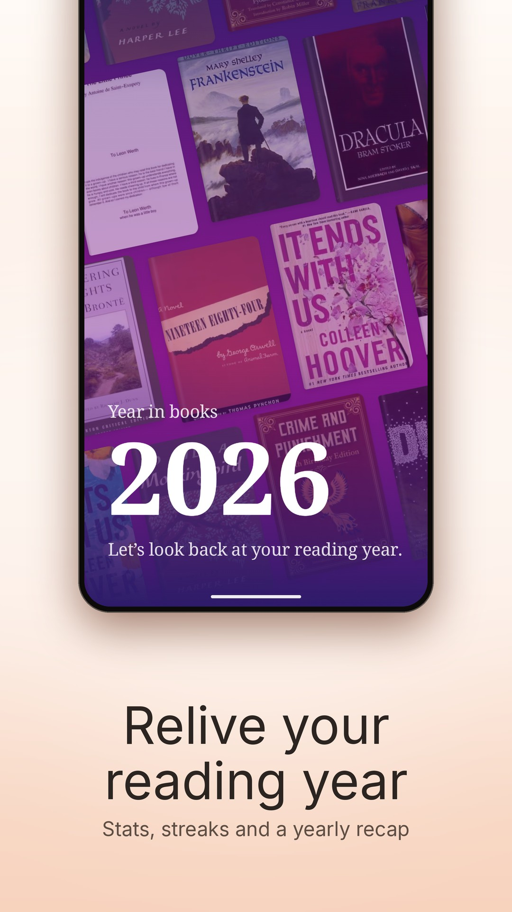
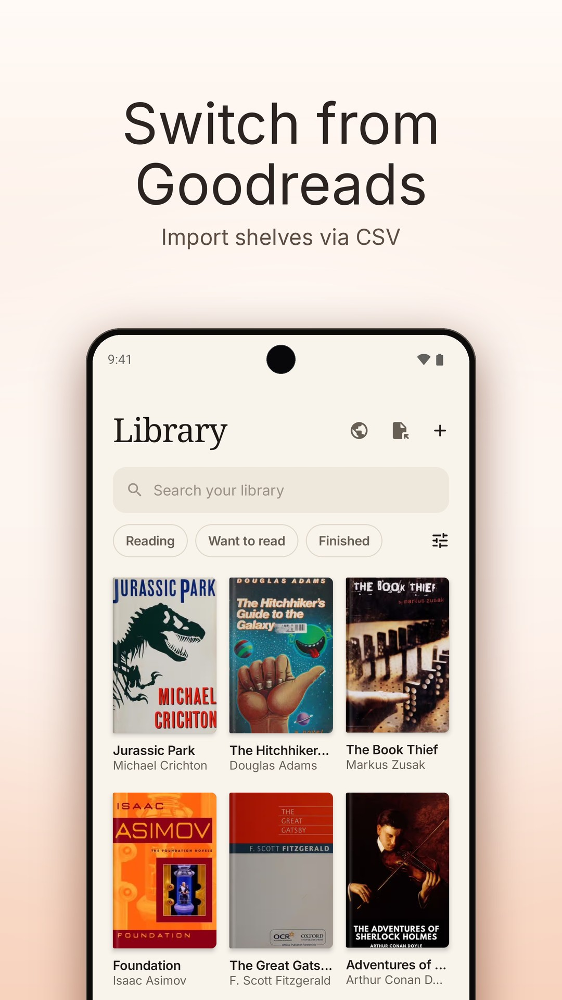
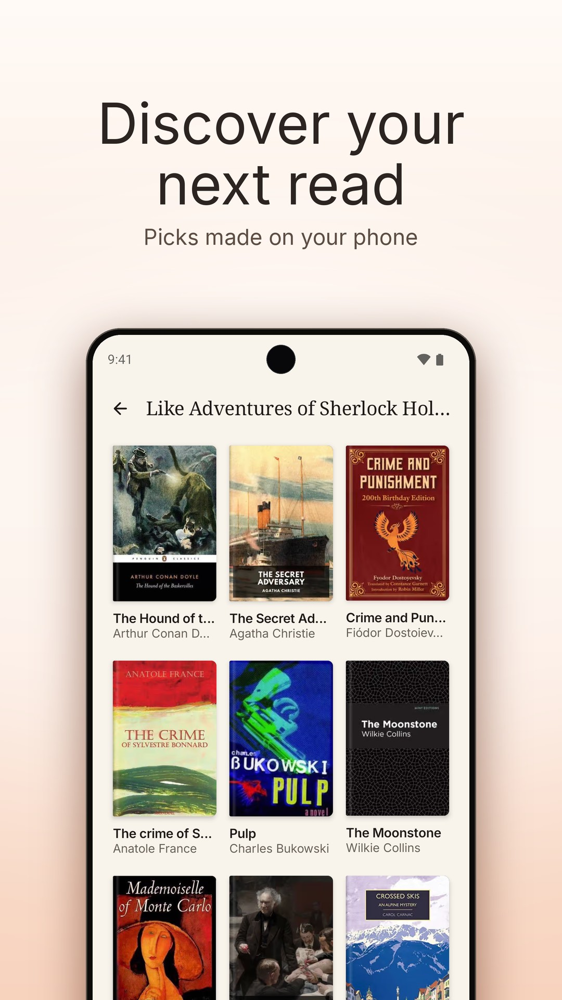
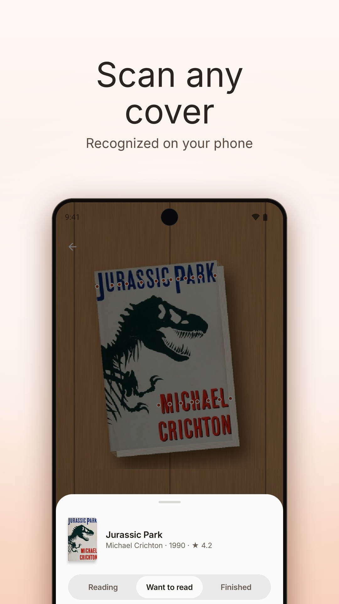
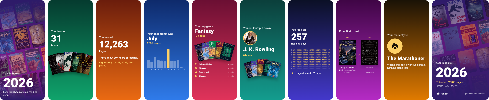

# Shelf

**The private book app for Android: find, track and read books, fully offline.**
No account. No ads. No tracking. Free and open source.

<picture><source media="(prefers-color-scheme: dark)" srcset="android/design/screenshots/dark/1_home.jpg"></picture>
<picture><source media="(prefers-color-scheme: dark)" srcset="android/design/screenshots/dark/2_listen.jpg"></picture>
<picture><source media="(prefers-color-scheme: dark)" srcset="android/design/screenshots/dark/3_reader.jpg"></picture>
<picture><source media="(prefers-color-scheme: dark)" srcset="android/design/screenshots/dark/4_book.jpg"></picture>
 
<picture><source media="(prefers-color-scheme: dark)" srcset="android/design/screenshots/dark/5_wrapped.jpg"></picture>
<picture><source media="(prefers-color-scheme: dark)" srcset="android/design/screenshots/dark/6_library.jpg"></picture>
<picture><source media="(prefers-color-scheme: dark)" srcset="android/design/screenshots/dark/7_explore.jpg"></picture>
<picture><source media="(prefers-color-scheme: dark)" srcset="android/design/screenshots/dark/8_scan.jpg"></picture>

https://github.com/user-attachments/assets/5ffe8161-7070-4fbc-8a89-836da15b2b37

## Why Shelf?

<table>
<tr>
<td width="33%" valign="top">

### 🔎 Find any book
The whole catalogue lives on your phone. Search works in airplane mode, forgives typos
and finds authors, series and ISBNs.

</td>
<td width="33%" valign="top">

### 📷 Scan a cover
Point your camera at a book. Shelf reads the title and series on your phone and
finds it.
Barcodes work too.

</td>
<td width="33%" valign="top">

### 🔥 Keep your streak
Set a daily page goal and watch the week fill up. Tap the streak for pages, books and
genres per month, plus your year in books.

</td>
</tr>
<tr>
<td valign="top">

### 📖 Read your ebooks
Open EPUB, Kindle, PDF, comics, Word files and more. Highlight in four colours, add
notes, export them as Markdown. Paper and night pages, e-ink mode, volume-key turns.

</td>
<td valign="top">

### ✨ Discover
Browse genres, follow series and authors, get recommendations worked out on your phone.
Download free classics if you like.

</td>
<td valign="top">

### 🔒 Stay private
No account, no ads, no trackers. One switch turns off all network. Your library never
leaves your phone.

</td>
</tr>
</table>

## Your year in books

Tap the streak card for monthly pages, books and genres. **Your year in books** replays
it as stories with your covers and ends on a card to share. All on your phone.

## Highlights and notes

Long-press to highlight, add a note, then export as Markdown or a CSV for Readwise.

## Listen to your books

Tap the headphones in the reader. Your phone's own speech engine reads aloud, no AI
models, no network. Shelf finds where the story starts and ends, skipping covers,
contents, copyright, dedications, acknowledgements and licence text, in any format
with text (PDF needs Android 15+). It highlights the spoken sentence and turns the
pages. Control it from the lock screen or headphones, set speed and voice, and use the
sleep timer (5-60 minutes with a slow fade-out, or end of chapter).

Have the audiobook? Add its files (MP3, M4B, M4A, OGG, Opus, FLAC, WAV) from the
listen sheet or the book page, import one from your library, or open it with Shelf:
Shelf reads the tags, pins it to the matching book, and plays it with the same
controls. Chapters inside a single M4B work like separate files. Picked files stay
where they are; files another app hands over are copied, since that access ends.

Optional voice models (Settings → Reading → Voice models) are separate downloads for
speaker detection and natural voices. Listening works without them. Each model lists
its size, licence and SHA-256, downloads pause and resume, and models too large for
the phone's memory are hidden. Only openly licensed models and voices are offered.

Kotlin: `data/Speech.kt` (extractor, language guess, sleep helpers), `Playback.kt`,
`Narrator.kt` and `NarrationService.kt` (Android TTS, media session),
`AudiobookPlayer.kt` and `data/Audiobooks.kt` (audiobook files, tags, MP4 chapters,
matching), `ui/Listen.kt` (player sheet), `data/Models.kt` and `ui/VoiceModels.kt`
(voice models), `data/Tokenizer.kt`, `data/SpeakerModel.kt` and
`android/app/src/main/cpp` (speaker model inference). Model tooling: `tooling/voices`.
Samples: `android/app/src/test/samples`.

## Switch from Goodreads or StoryGraph in a minute

| 1. Export | 2. Import | 3. Done |
|:---:|:---:|:---:|
| Download your CSV from Goodreads or StoryGraph | Shelf › Settings › Your data › **Import CSV** | Shelves, ratings and read dates carry over |

## No cover? Shelf draws one

Every book without a cover gets its own, drawn on your phone in the style of its genre.
Prefer your own picture? Tap the cover to pick one.

## Reads what you have

`EPUB` `MOBI` `AZW3` `PDF` `FB2` `CBZ` `CBR` `CB7` `DOCX` `ODT` `RTF` `HTML` `TXT` `MD`

Open a file from any app or import it into your library. Add books missing from the
catalogue as your own, with your own cover.

## Books in your language

**Catalogue:** English · Deutsch · Français · Español · Eesti · Svenska · Polski ·
Čeština · 한국어 · Suomi · 日本語 · Latviešu · Português · Русский · Italiano, with optional
packs for fantasy, sci-fi, mystery, romance, kids, young adult and non-fiction.

**App:** all catalogue languages; Português in Brazilian and European variants.
[Help translate](https://hosted.weblate.org/engage/shelf/), no coding needed.

## Private by design

- ✅ No account, no ads, no trackers
- ✅ Nothing sent on first launch
- ✅ One switch cuts all network
- ✅ Cover scanner runs on your phone, pictures never stored
- ✅ Free ebook sources stay off until you turn them on
- ✅ Open source: anyone can check the code

## Questions

<b>Is Shelf really free?</b>

Yes. No ads, no in-app purchases, no subscription. Shelf is open source under the MIT
license.

<b>Do I need internet?</b>

No. English comes built in. Other languages download once, then everything works
offline. Covers load online only if you allow it.

<b>Which download should I pick?</b>

- **F-Droid**: if you already use the F-Droid store.
- **Obtainium**: automatic updates straight from this page.
- **GitHub**: download the APK directly; Shelf tells you about updates itself.

Shelf needs Android 8 or newer.

<b>Can I back up my library?</b>

Yes. Shelf can save a daily backup to a folder you choose, for example a Syncthing
folder. You can also export everything as CSV, your highlights and notes as Markdown,
and move your library to a new phone.

<b>Does it work on tablets?</b>

Yes. Wide screens show the book next to the list, and the reader keeps lines
comfortable to read.

## Support Shelf

- ⭐ **Star this repo**: it helps others find Shelf
- 🌍 [**Translate**](https://hosted.weblate.org/engage/shelf/) into your language
- 🐞 [**Report a bug**](https://github.com/tn3w/Shelf/issues/new/choose) or
  [**share an idea**](https://github.com/tn3w/Shelf/discussions)
- ☕ [**Buy me a coffee**](https://buymeacoffee.com/tn3w)

Developers: building, architecture and the catalogue pipeline are in
[CONTRIBUTING.md](.github/CONTRIBUTING.md).

---

<a href="LICENSE">MIT License</a> · <a href=".github/SECURITY.md">Security</a> ·
<a href=".github/CODE_OF_CONDUCT.md">Code of conduct</a> · Book data from
<a href="https://openlibrary.org">Open Library</a>, <a href="https://www.wikidata.org">Wikidata</a>,
<a href="https://www.gutenberg.org">Project Gutenberg</a> and the national libraries of Germany
(DNB), Estonia (ERB), France (BnF), Sweden (LIBRIS), Poland (BN), the Czech Republic
(NKP), Korea (NLK), Finland (Fennica), the UK (BNB, English series), Spain (BNE), Latvia
(LNB) and Portugal (BNP), plus the Library of Congress for Portuguese, Russian and Italian. Japanese records: NACSIS-CAT via <a href="https://ci.nii.ac.jp/books/">CiNii
Books</a>, National Institute of Informatics,
<a href="https://creativecommons.org/licenses/by/4.0/">CC BY 4.0</a>.

