

# Shelf

**The private book app for Android: find, track and read books, fully offline.**
No account. No ads. No tracking. Free and open source.

<picture><source media="(prefers-color-scheme: dark)" srcset="android/design/screenshots/dark/1_home.jpg">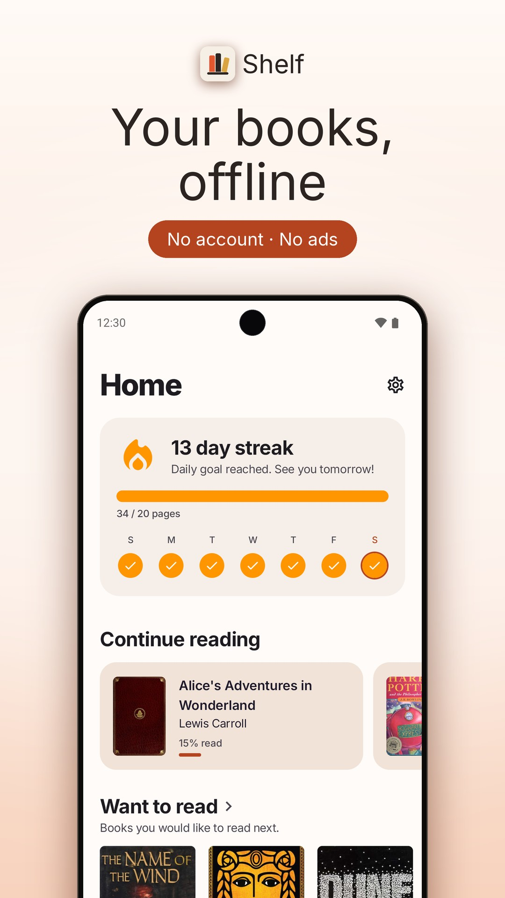</picture>
<picture><source media="(prefers-color-scheme: dark)" srcset="android/design/screenshots/dark/2_listen.jpg">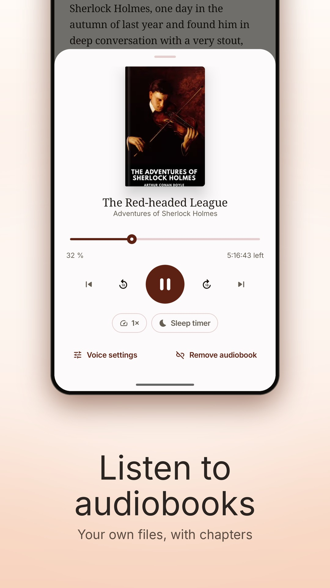</picture>
<picture><source media="(prefers-color-scheme: dark)" srcset="android/design/screenshots/dark/3_reader.jpg">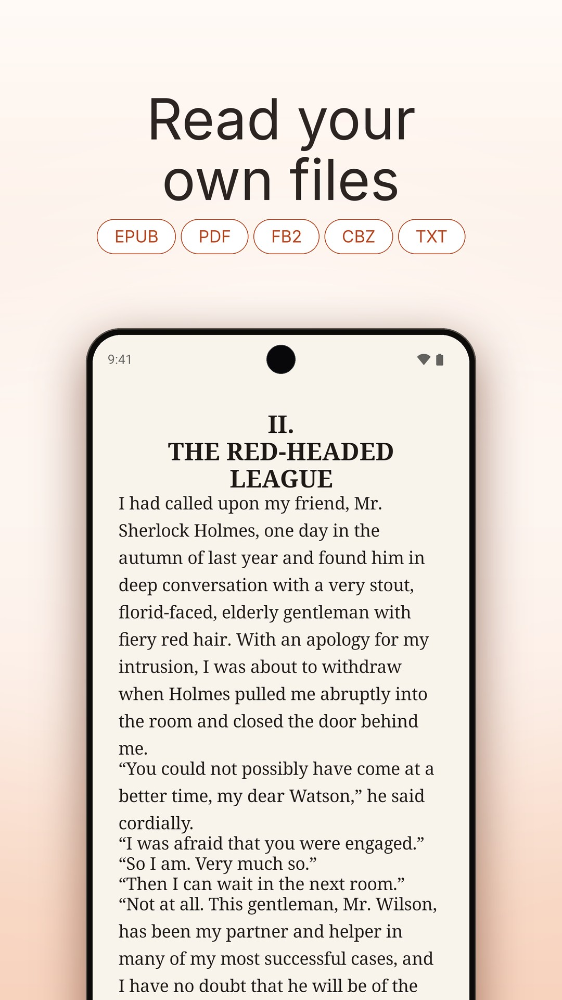</picture>
<picture><source media="(prefers-color-scheme: dark)" srcset="android/design/screenshots/dark/4_book.jpg">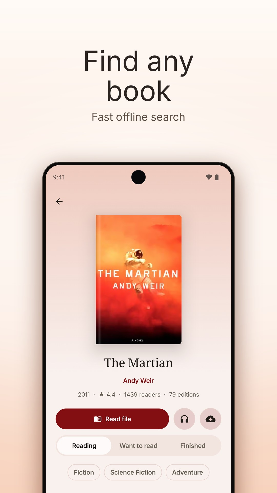</picture>
 
<picture><source media="(prefers-color-scheme: dark)" srcset="android/design/screenshots/dark/5_wrapped.jpg">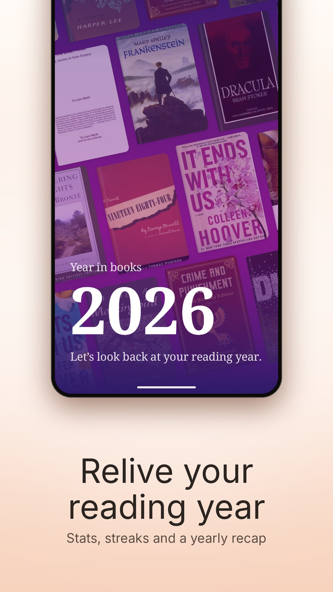</picture>
<picture><source media="(prefers-color-scheme: dark)" srcset="android/design/screenshots/dark/6_library.jpg">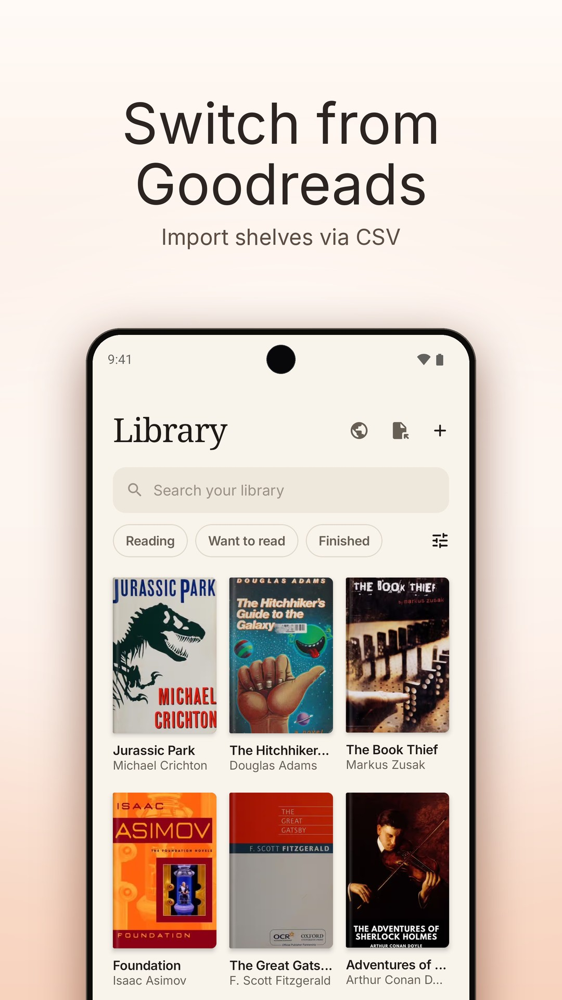</picture>
<picture><source media="(prefers-color-scheme: dark)" srcset="android/design/screenshots/dark/7_explore.jpg">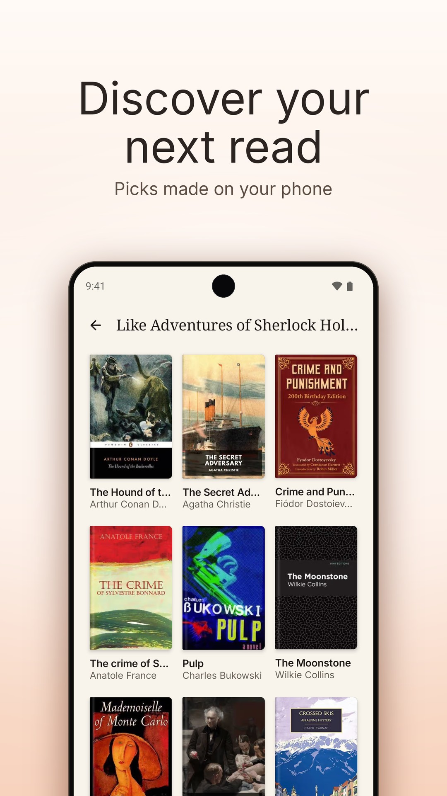</picture>
<picture><source media="(prefers-color-scheme: dark)" srcset="android/design/screenshots/dark/8_scan.jpg">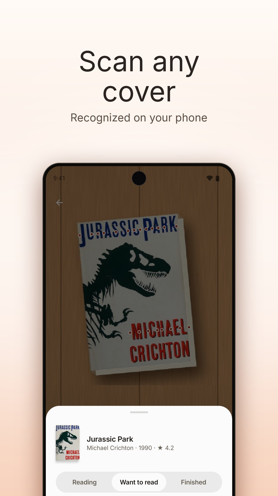</picture>

https://github.com/user-attachments/assets/7264823b-87bf-42f3-b9d0-bf1d1927186a

## Why Shelf?

<table>
<tr>
<td width="25%" valign="top">

### 📚 Your books, offline
The whole catalogue lives on your phone. No account, no ads, nothing sent on first
launch.

</td>
<td width="25%" valign="top">

### 🎧 Listen
Play your own audiobooks with chapters, or let your phone read any ebook aloud, also
in Android Auto.

</td>
<td width="25%" valign="top">

### 📖 Read your files
EPUB, Kindle, PDF, comics, Word and more, with highlights, notes and night pages.

</td>
<td width="25%" valign="top">

### 🔎 Find any book
Search forgives typos and finds titles, authors, series and ISBNs in airplane mode.

</td>
</tr>
<tr>
<td valign="top">

### 🔥 Your reading year
Daily goal, streaks, monthly stats and a yearly recap to share.

</td>
<td valign="top">

### ↪️ Switch from Goodreads
Import your shelves, ratings and read dates from a CSV.

</td>
<td valign="top">

### ✨ Discover
Recommendations, genres, series and authors, all worked out on your phone.

</td>
<td valign="top">

### 📷 Scan a cover
Point your camera at a book. Shelf recognizes it on your phone. Barcodes work too.

</td>
</tr>
</table>

## Your reading year

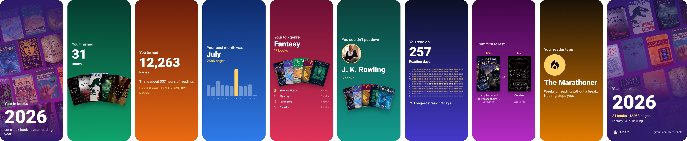

Daily goal, streaks and monthly stats, replayed as stories with a card to share.

## Covers for every book

Books without a cover get one, drawn on your phone in the style of their genre.

## Widgets

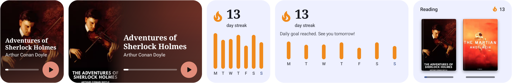

Continue your book from the home screen, in the colours of its cover. Your streak and
everything you are reading sit beside it in your phone's colours.

## Android Auto

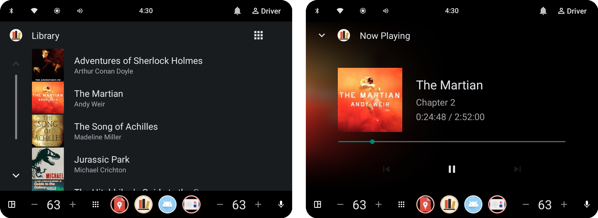

Pick up your audiobook or have any ebook read aloud in the car, with covers, chapters
and voice search.

## Reads your files

`EPUB` `MOBI` `AZW3` `PDF` `FB2` `CBZ` `CBR` `CB7` `DOCX` `ODT` `RTF` `HTML` `TXT` `MD`
· `MP3` `M4B` `M4A` `OGG` `Opus` `FLAC` `WAV`

## In your language

English · Deutsch · Français · Español · Eesti · Svenska · Polski · Čeština · 한국어 ·
Suomi · 日本語 · Latviešu · Português · Русский · Italiano · Nederlands (app)

## Questions

<b>Is Shelf really free?</b>

Yes. No ads, no in-app purchases, no subscription. Shelf is open source under the MIT
license.

<b>Do I need internet?</b>

No. English comes built in. Other languages download once, then everything works
offline. Covers load online only if you allow it.

<b>Which download should I pick?</b>

- **F-Droid**: if you already use the F-Droid store.
- **Obtainium**: automatic updates straight from this page.
- **GitHub**: download the APK directly; Shelf tells you about updates itself.

Shelf needs Android 8 or newer.

<b>Can I back up my library?</b>

Yes. Shelf can save a daily backup to a folder you choose, for example a Syncthing
folder. You can also export everything as CSV, your highlights and notes as Markdown,
and move your library to a new phone.

<b>Does it work on tablets?</b>

Yes. Wide screens show the book next to the list, and the reader keeps lines
comfortable to read.

## Support Shelf

- ⭐ **Star this repo**: it helps others find Shelf
- 🌍 [**Translate**](https://hosted.weblate.org/engage/shelf/) into your language
- 🐞 [**Report a bug**](https://github.com/tn3w/Shelf/issues/new/choose) or
  [**share an idea**](https://github.com/tn3w/Shelf/discussions)
- ☕ [**Buy me a coffee**](https://buymeacoffee.com/tn3w)

Developers: building, architecture and the catalogue pipeline are in
[CONTRIBUTING.md](.github/CONTRIBUTING.md).

---

<a href="LICENSE">MIT License</a> · <a href=".github/SECURITY.md">Security</a> ·
<a href=".github/CODE_OF_CONDUCT.md">Code of conduct</a>
  
Book data:
<a href="https://openlibrary.org">Open Library</a> (CC0) ·
<a href="https://www.wikidata.org">Wikidata</a> (CC0) ·
<a href="https://www.gutenberg.org">Project Gutenberg</a> (public domain) ·
<a href="https://data.dnb.de/opendata/">DNB</a> Germany (CC0) ·
<a href="https://data.digar.ee/">ERB</a> Estonia (CC0) ·
<a href="https://www.bnf.fr/fr/les-donnees-de-la-bnf">BnF</a> France (Licence Ouverte) ·
<a href="https://libris.kb.se/">LIBRIS</a> Sweden (CC0) ·
<a href="https://data.bn.org.pl/">BN</a> Poland (CC0) ·
<a href="https://aleph.nkp.cz/data/">NKP</a> Czech Republic (CC0) ·
<a href="https://lod.nl.go.kr/">NLK</a> Korea (KOGL type 1) ·
<a href="https://data.nationallibrary.fi/">Fennica</a> Finland (CC0) ·
<a href="https://bl.iro.bl.uk/server/api/core/items/d194ffaf-4d53-4313-b6f2-25a97f92e99f">BNB</a> UK (CC0) ·
<a href="https://www.bne.es/es/catalogos/datos-enlazados">BNE</a> Spain (CC0) ·
<a href="https://ci.nii.ac.jp/books/">CiNii Books</a> Japan, NACSIS-CAT, National Institute
of Informatics (<a href="https://creativecommons.org/licenses/by/4.0/">CC BY 4.0</a>) ·
<a href="https://dati.lnb.lv/">LNB</a> Latvia (CC0) ·
<a href="https://opendata.bnportugal.gov.pt/">BNP</a> Portugal (CC0) ·
<a href="https://www.loc.gov/cds/products/MDSConnect-books_all.html">Library of Congress</a>
(public domain).
Voice models list their own open licence and source in the app.

